<p align="center">
  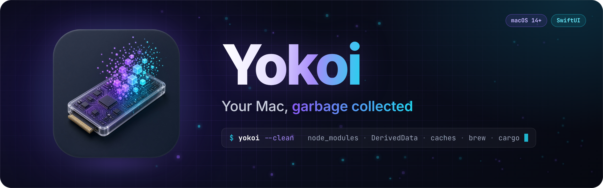
</p>

<p align="center">
  A native macOS cleaner built for developers.<br>
  It finds the gigabytes your toolchains leave behind and removes them safely.
</p>

<p align="center">
  
  
  
  
  
  
</p>

<p align="center">
  <a href="#what-it-cleans">What it cleans</a> ·
  <a href="#safe-by-design">Safety</a> ·
  <a href="#install">Install</a> ·
  <a href="#faq">FAQ</a> ·
  <a href="docs/DEVELOPMENT.md">Contributing</a>
</p>

<br>

<p align="center">
  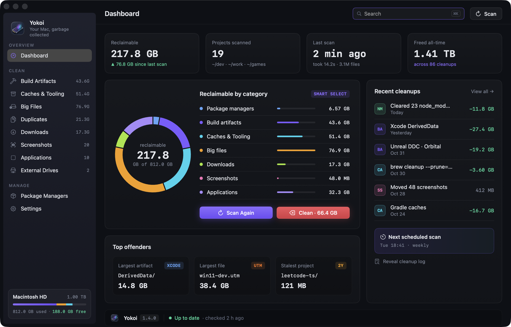
</p>

<br>

## Why Yokoi

A developer's Mac fills up quietly. There are `node_modules` in every repo you cloned once, Rust `target/` folders, Xcode DerivedData, Unity `Library/`, Unreal's DerivedDataCache, package caches, dead simulators, forgotten VMs, and a Desktop full of screenshots.

Generic cleaners don't understand any of that. `rm -rf` does, but it doesn't forgive mistakes.

Yokoi knows where developer clutter lives and what's safe to remove. It shows you what it found and why, then cleans it with a Trash-first, log-everything, undo-able safety net.

<br>

## What it cleans

| | Finds | How it decides |
|---|---|---|
| **📦 Package managers** | **Project `node_modules`** for npm · pnpm · yarn · bun, with framework, lockfile and last-touched date. **Global packages and environments** for 17 managers (Homebrew, Cargo, pip, conda…), with outdated and unused flags | node_modules is marked **stale** after 90 days untouched (configurable), and active projects start unchecked. Every update or uninstall shows the exact command and asks first |
| **🔨 Build artifacts** | `target/`, `.build/`, DerivedData, `build/`, `.gradle/`, `.venv`, `__pycache__`, `bin/obj`, `.next`, Unity `Library/`, Unreal `Intermediate/` + `DerivedDataCache/`… | Only matched **next to the project's marker file**, so a random `target/` folder is never touched |
| **🗄️ Caches** | npm, Yarn, pnpm, Bun, Homebrew, Cargo, Gradle (+ wrapper distributions), CocoaPods, pip, Xcode, simulators, **Android emulators, system images and build cache**, browsers, Ollama / Hugging Face / LM Studio models, installers in Downloads, Trash | Every location is tagged **Safe**, **Re-download** or **Review**. Emulators that are running are refused |
| **🧰 Tool cleanups** | Unavailable iOS simulators, local Time Machine snapshots, **unused Docker images, Docker build cache and dangling volumes** | Done through the tool itself (`xcrun simctl`, `tmutil`, `docker`), with the exact command shown first. Volumes are listed by name, so nothing created later is swept up |
| **🐘 Big files** | Videos, archives, disk images, VMs (`.utm`, `.vmdk`…), 3D and art files | Log-scale size slider from 100 MB to 10 GB+, with filters by type |
| **📸 Screenshots** | Screenshots and screen recordings in your screenshot folder | File them into `YYYY/MM` folders or trash them, by hand or with a daily rule |
| **🧩 Applications** | Installed apps with size, last opened, and their leftovers in `~/Library` | Uninstalls the app *and* its support files. Apple apps and running apps are locked |
| **💽 External drives** | The drive's own Trash, `.DS_Store` files, `._` AppleDouble files on exFAT/FAT/NTFS | Can also include a drive in project and big-file scans. Time Machine disks are locked |

<details>
<summary><strong>Supported toolchains and package managers</strong></summary>

<br>

**Build artifacts:** Rust · Xcode · Swift PM · Gradle / Android · Python · .NET · Unity · Unreal Engine · Go · Next.js / Nuxt / SvelteKit / Turbo / Parcel · CMake

**Android:** emulators (AVDs) · SDK system images · SDK cache · Android Gradle build cache · Gradle wrapper distributions

**Docker** (through the `docker` CLI, Docker Desktop, OrbStack or Colima): unused images · BuildKit build cache · dangling volumes

**Package managers** (project `node_modules` for npm · pnpm · Yarn · Bun, plus global packages): npm · pnpm · Yarn · Bun · Homebrew · Homebrew Casks · MacPorts · Mac App Store (`mas`) · Cargo · Go · .NET tools · pip · pipx · uv · conda · RubyGems · Composer

Adding a language is one entry in a rule table. See [docs/DEVELOPMENT.md](docs/DEVELOPMENT.md).
</details>

<br>

## A quick tour

<table>
  <tr>
    <td width="50%">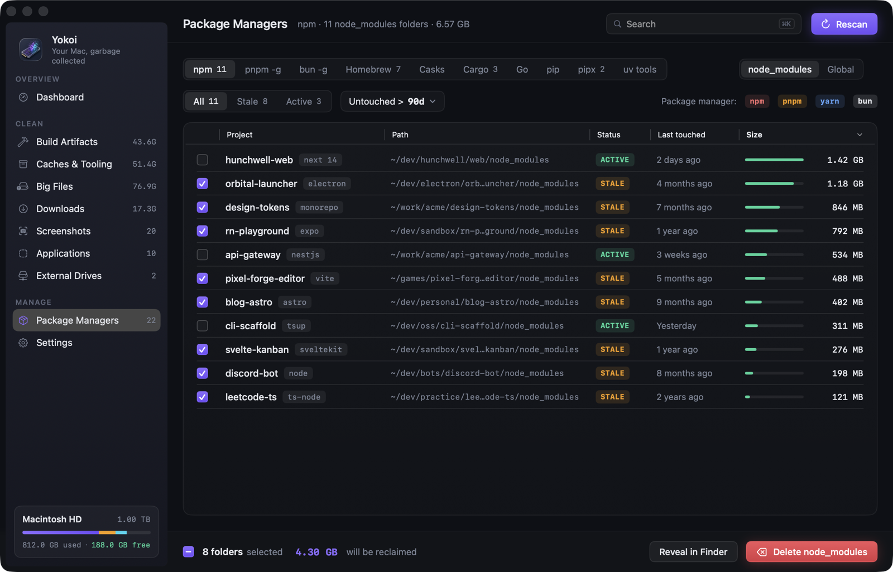<br><sub><b>Package managers → npm</b> · every node_modules folder, stale ones preselected</sub></td>
    <td width="50%">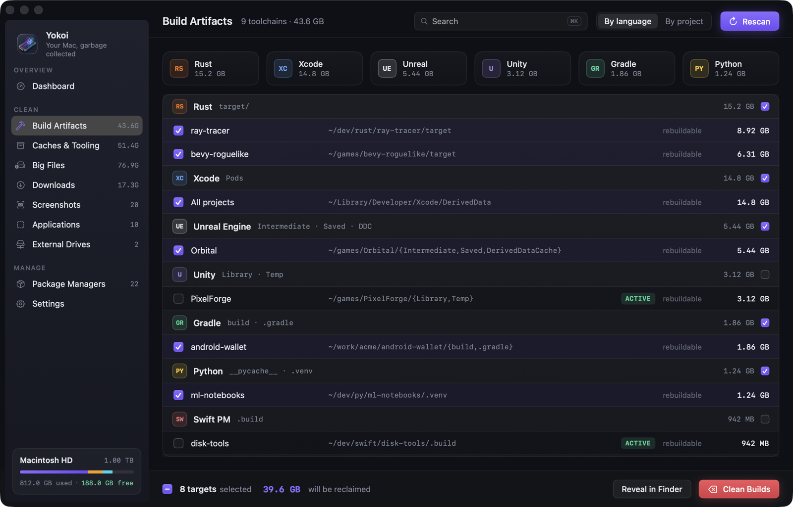<br><sub><b>Build artifacts</b> · grouped by toolchain, matched by marker files</sub></td>
  </tr>
  <tr>
    <td>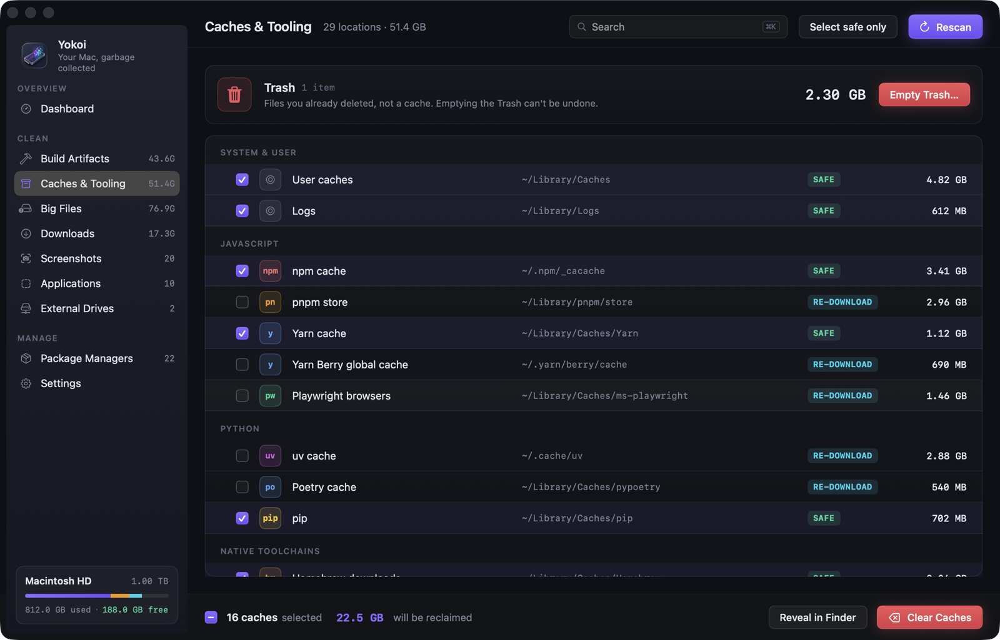<br><sub><b>Caches</b> · tagged Safe, Re-download or Review</sub></td>
    <td>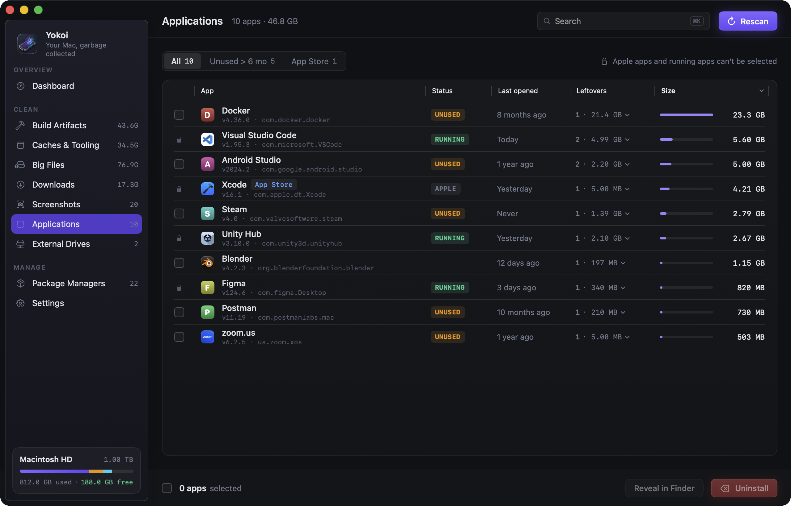<br><sub><b>Applications</b> · uninstall apps together with their leftovers</sub></td>
  </tr>
  <tr>
    <td>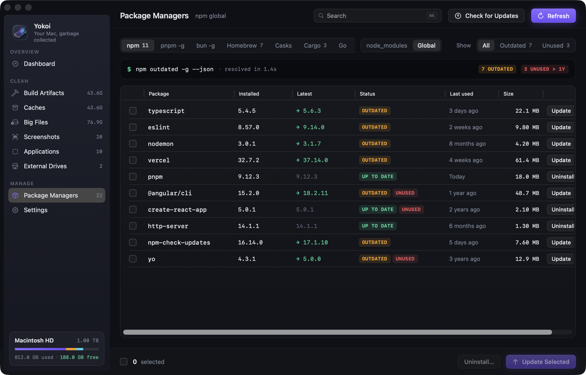<br><sub><b>Package managers → global</b> · outdated and unused global packages</sub></td>
    <td>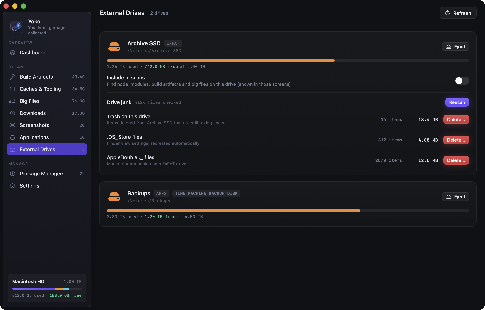<br><sub><b>External drives</b> · drive Trash, .DS_Store and ._ files</sub></td>
  </tr>
  <tr>
    <td>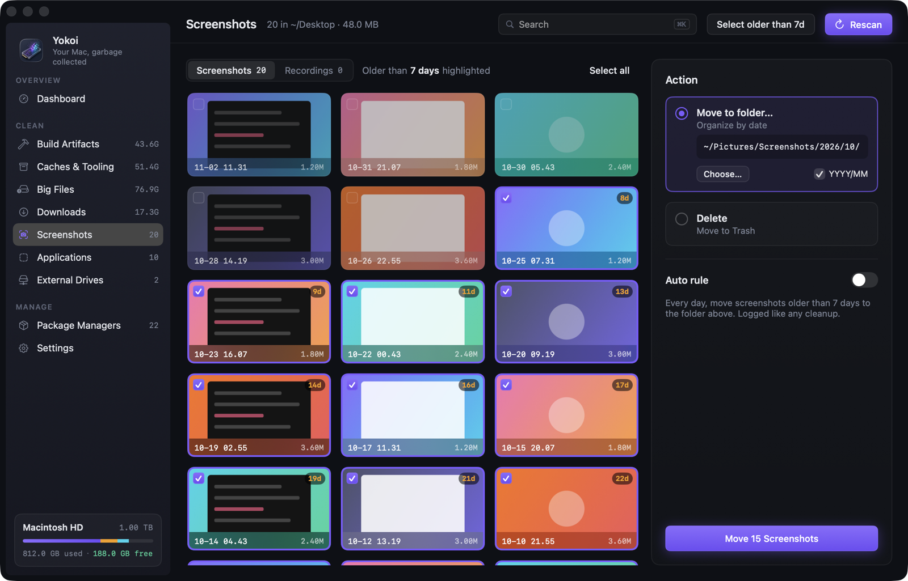<br><sub><b>Screenshots</b> · file them by month, or clear them out</sub></td>
    <td>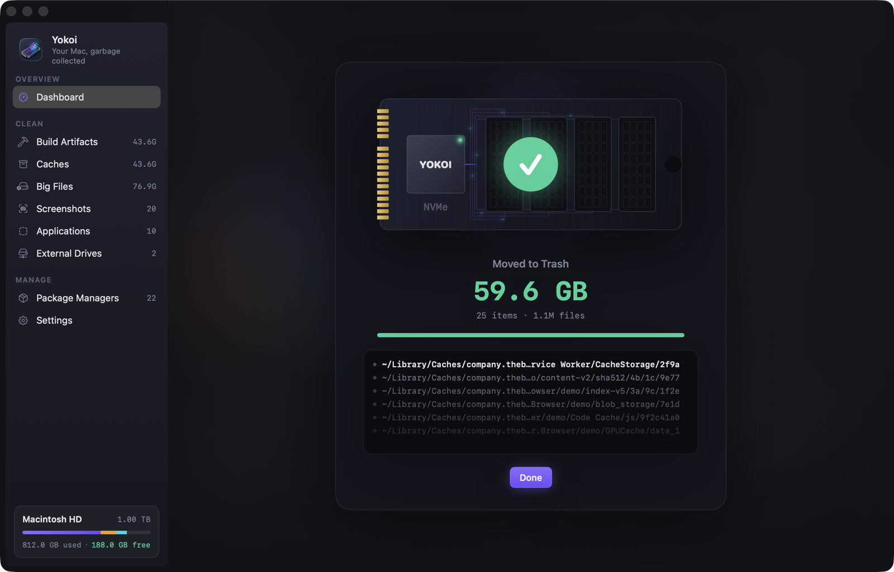<br><sub><b>Done</b> · what was freed, and Put Back if you change your mind</sub></td>
  </tr>
</table>

<br>

## Safe by design

Yokoi deletes things for a living, so it's built to be paranoid.

- **Trash first.** Everything goes to the Trash by default. Permanent delete is an explicit, red, every-time choice.
- **Undo.** Every Trash cleanup can be **Put Back** from the dashboard, as long as the items are still in the Trash. Nothing is ever overwritten on the way back.
- **Dry run.** Preview exactly what would happen, with sizes, without touching a byte.
- **Scoped access.** Each category can only touch its own folders. node_modules cleanup can't reach your Downloads, and caches cleanup can't reach your projects.
- **Hands off your life.** Keychains, Mail, Messages, iCloud Drive, cloud storage, Photos libraries, `/System` and `.git` are blocked unconditionally, even if you add them by accident.
- **Busy means no.** Projects open in Xcode, Unity, Unreal or a running `node` process, running apps, and Android emulators that are booted are refused. Yokoi checks twice: when you confirm and again right before acting.
- **Recent means careful.** Projects you touched in the last 14 days start unchecked and need an extra confirmation.
- **No escalation.** Yokoi never runs `sudo`. Command-line tools are run without a shell, and arguments are passed literally, so package names can't inject commands.
- **Symlink-proof.** Symlinks are removed, never followed. Paths are checked both as written and with symlinks resolved.
- **Look, don't touch.** The `yokoi` command and the Shortcuts actions only scan and report. Cleaning always goes through the app's confirmation sheet.
- **Everything is logged.** Every cleanup is written to `~/Library/Application Support/Yokoi/cleanup.log` with path, size, action and where it went.

<p align="center">
  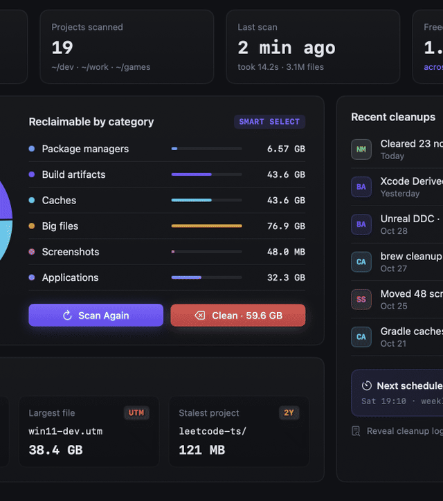
</p>

> [!TIP]
> When you clean, Yokoi shows an animated SSD whose flash cells erase as files go, a live counter of space freed, and the paths being removed, so it never looks frozen.

<br>

## Install

**Requirements:** macOS 14 Sonoma or later · Apple Silicon or Intel

### Download

**[Download Yokoi 1.0](https://github.com/indieocean/yokoi/releases/latest)** (`.dmg`, signed and notarized). Open it, drag Yokoi to Applications, and launch.

Every release is on the [Releases](https://github.com/indieocean/yokoi/releases) page, with a SHA-256 checksum.

### Build from source

```sh
git clone https://github.com/indieocean/yokoi.git
cd yokoi
open Yokoi.xcodeproj   # then press ⌘R
```

You'll need Xcode 16 or later. The project signs with your own Apple Development team; pick it under **Signing & Capabilities** if Xcode asks.

### Grant Full Disk Access (recommended)

Some caches and folders are protected by macOS. To let Yokoi measure them:

1. Open **System Settings → Privacy & Security → Full Disk Access**
2. Turn on **Yokoi** (use **+** if it isn't listed)
3. Switch back to Yokoi. It notices the change automatically.

Yokoi works without it too. It just skips what it can't read.

<br>

## Everyday use

- **Scan** from the dashboard or with `⌘⇧R`. Results appear as they're found.
- **Clean ·** on the dashboard runs *Smart Select*: stale node_modules, artifacts of inactive projects and Safe caches.
- Search any list with `⌘K`, rescan the current screen with `⌘R`, and clean the selection with `⌘⌫`.
- Optional **menu bar helper** shows free and reclaimable space, with one-click access.
- Optional **scheduled scans** (daily, weekly or monthly) run at low priority, with a notification when reclaimable space passes a threshold.
- **Shortcuts and Siri:** *Scan for Reclaimable Space* (returns bytes), *Get Free Disk Space* and *Open Yokoi* on any screen. None of them deletes anything.

### Command line

The app binary doubles as a read-only `yokoi` command. Link it once (Settings → Command line & Shortcuts has a copy button):

```sh
sudo ln -sf /Applications/Yokoi.app/Contents/MacOS/Yokoi /usr/local/bin/yokoi
```

```sh
yokoi scan                                  # summary + 5 largest items per category
yokoi scan --json | jq .reclaimableBytes    # full report for scripts and CI
yokoi scan --category caches,build-artifacts --top 10
```

It uses the roots, exclusions and thresholds from Settings, and never deletes anything: cleaning stays in the app.

<br>

## Privacy

Yokoi is 100% local. It has no account, no analytics and no telemetry.

The only network traffic is package managers checking registries for newer versions, and only when you click **Check for Updates**.

<br>

## FAQ

<details>
<summary><strong>Is it safe to delete node_modules and build folders?</strong></summary>
<br>
Yes. They're rebuilt by your package manager or toolchain (<code>npm install</code>, <code>cargo build</code>, reopening the project in Unity…). Yokoi shows the restore command before you confirm, and only matches build folders next to their project files.
</details>

<details>
<summary><strong>Can I undo a cleanup?</strong></summary>
<br>
Anything moved to the Trash can be put back from <em>Recent cleanups</em> on the dashboard, until you empty the Trash. Permanent deletes can't be undone, which is why they always need an extra confirmation.
</details>

<details>
<summary><strong>Why does it want Full Disk Access?</strong></summary>
<br>
macOS protects some caches and folders. Without access Yokoi can't measure them and skips them. Even with access, Yokoi never touches Keychains, Mail, Messages, iCloud Drive or Photos.
</details>

<details>
<summary><strong>Does it need my password or run anything as root?</strong></summary>
<br>
No. Yokoi never uses <code>sudo</code>. A few actions macOS reserves for administrators, like changing MacPorts or deleting some Time Machine snapshots, are shown as commands you can run yourself.
</details>

<details>
<summary><strong>What does "garbage collected" mean here?</strong></summary>
<br>
It's the same idea as in a runtime: find what's no longer reachable from your active work, such as stale dependencies, rebuildable output and caches nobody reads, and reclaim it, without touching anything still in use.
</details>

<br>

## Roadmap

- [x] Signed and notarized releases
- [x] Docker images, build cache and volumes
- [x] Android SDK and emulators
- [ ] Incremental rescans (FSEvents)
- [x] `yokoi` command-line companion (`yokoi scan --json`)
- [x] Shortcuts and App Intents

<br>

## Contributing

Issues and pull requests are welcome. Start with [docs/DEVELOPMENT.md](docs/DEVELOPMENT.md) for the architecture, the rule tables and how to run the test suite (`⌘U`).

<br>

<p align="center">
  <sub>Made for developers who've typed <code>du -sh * | sort -h</code> one too many times.</sub>
</p>
