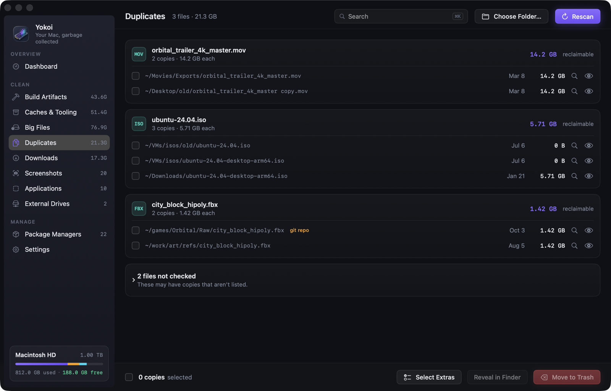
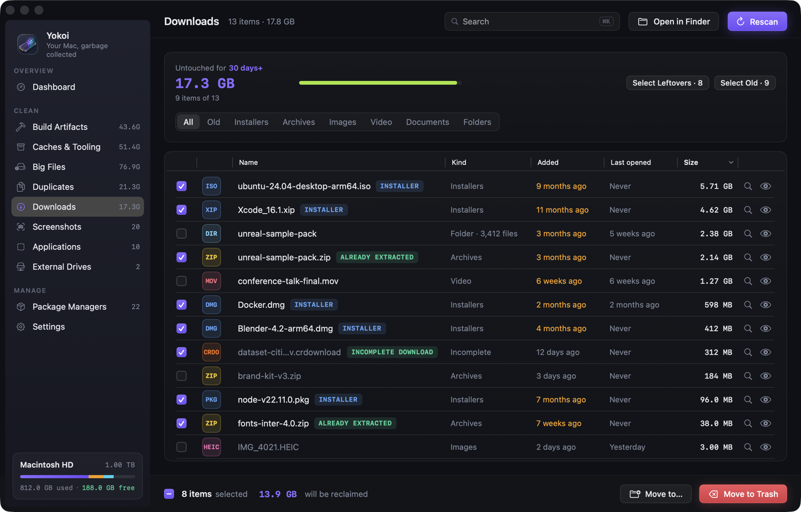

<p align="center">
  
</p>

<p align="center">
  A native macOS cleaner built for developers.<br>
  It finds the gigabytes your toolchains leave behind and removes them safely.
</p>

<h3 align="center">🍺 Install with Homebrew</h3>

```sh
brew install --cask indieocean/tap/yokoi
```

<p align="center">
  Or <a href="https://github.com/indieocean/yokoi/releases/latest"><b>download the .dmg</b></a> · macOS 14+ · signed and notarized · free and open source
</p>

<p align="center">
  <a href="https://www.producthunt.com/products/yokoi?embed=true&amp;utm_source=badge-featured&amp;utm_medium=badge&amp;utm_campaign=badge-yokoi" target="_blank" rel="noopener noreferrer"></a>
</p>

<p align="center">
  
  
  
  
  
  
  <a href="LICENSE"></a>
  <a href="https://buymeacoffee.com/theranchsteamlab"></a>
</p>

<p align="center">
  <a href="#what-it-cleans">What it cleans</a> ·
  <a href="#safe-by-design">Safety</a> ·
  <a href="#install">Install</a> ·
  <a href="#faq">FAQ</a> ·
  <a href="docs/DEVELOPMENT.md">Contributing</a>
</p>

<br>

<p align="center">
  
</p>

<br>

## Why Yokoi

A developer's Mac fills up quietly. There are `node_modules` in every repo you cloned once, Rust `target/` folders, Xcode DerivedData, Unity `Library/`, Unreal's DerivedDataCache, package caches, dead simulators, forgotten VMs, and a Desktop full of screenshots.

Generic cleaners don't understand any of that. `rm -rf` does, but it doesn't forgive mistakes.

Yokoi knows where developer clutter lives and what's safe to remove. It shows you what it found and why, then cleans it with a Trash-first, log-everything, undo-able safety net.

<br>

## What it cleans

| | Finds | How it decides |
|---|---|---|
| **📦 Package managers** | **Project `node_modules`** for npm · pnpm · yarn · bun, with framework, lockfile and last-touched date. **Global packages and environments** for 17 managers (Homebrew, Cargo, pip, conda…), with outdated and unused flags | node_modules is marked **stale** after 90 days untouched (configurable), and active projects start unchecked. Every update or uninstall shows the exact command and asks first |
| **🔨 Build artifacts** | `target/`, `.build/`, DerivedData, `build/`, `.gradle/`, `.venv`, `__pycache__`, `bin/obj`, `.next`, Unity `Library/`, Unreal `Intermediate/` + `DerivedDataCache/`… | Only matched **next to the project's marker file**, so a random `target/` folder is never touched |
| **🗄️ Caches & Tooling** | JavaScript (npm, Yarn, pnpm, Bun, Deno, Playwright, Puppeteer, Electron), Python (pip, uv, Poetry), Homebrew, Cargo, Go modules, Gradle, Maven, NuGet, Flutter, SwiftPM, CocoaPods, Xcode and simulators, **Android emulators, system images and build cache**, VS Code, Cursor and JetBrains caches, Docker Desktop and OrbStack, browsers, Ollama / Hugging Face / LM Studio, Trash | Every location is tagged **Safe**, **Re-download** or **Review**. Sizes count only what cleaning frees, so caches shared with projects through hardlinks or clones aren't overstated. Running emulators, simulators, Gradle daemons, editors and Docker block their own caches |
| **🤖 AI agents** | Caches and logs from the Claude app, Claude Code, Codex, ChatGPT, Grok, Copilot CLI and OpenCode. Session history for Claude Code, Grok, Gemini CLI and Copilot CLI, plus Claude Code checkpoints, old Grok versions and the Claude Cowork VM | Only what the agent rebuilds is **Safe**. History is **Review**, so it's never preselected or auto-cleaned. Logins, settings, skills, plugins and Claude project memory are never touched, the installed Grok is kept, and each agent's files wait until it quits. Codex sessions and Cursor chats stay too, because each agent tracks them in its own database |
| **🧰 Tool cleanups** | Unavailable iOS simulators, local Time Machine snapshots, **unused Docker images, Docker build cache and dangling volumes** | Done through the tool itself (`xcrun simctl`, `tmutil`, `docker`), with the exact command shown first. Volumes are listed by name, so nothing created later is swept up |
| **🐘 Big files** | Videos, archives, disk images, VMs (`.utm`, `.vmdk`…), 3D and art files | Log-scale size slider from 100 MB to 10 GB+, with filters by type |
| **👯 Duplicates** | Files of 1 MB or more with identical contents, across your big-file locations or in one folder you choose | Compared by SHA-256, only when you ask, because it reads the files. One copy always stays. Copies that are all inside git repos aren't listed unless you choose that folder, and sizes count what removing a copy really frees |
| **⬇️ Downloads** | Everything in `~/Downloads`: installers, archives, media, documents and folders, with when each was added and last opened | Items untouched for 30 days (configurable) count as reclaimable. Incomplete downloads and archives you already extracted are flagged as leftovers; your own files are never preselected |
| **📸 Screenshots** | Screenshots and screen recordings in your screenshot folder | File them into `YYYY/MM` folders or trash them, by hand or with a daily rule |
| **🧩 Applications** | Installed apps with size, last opened, and their leftovers in `~/Library` | Uninstalls the app *and* its support files. Files that only match by name stay unless you tick them, since any app can claim a name. Apple apps and running apps are locked |
| **💽 External drives** | The drive's own Trash, `.DS_Store` files, `._` AppleDouble files on exFAT/FAT/NTFS | Can also include a drive in project and big-file scans. Time Machine disks are locked |

<details>
<summary><strong>Supported toolchains and package managers</strong></summary>

<br>

**Build artifacts:** Rust · Xcode · Swift PM · CocoaPods (opt-in) · Gradle / Android · Python · .NET · Unity · Unreal Engine · Go · Next.js / Nuxt / SvelteKit / Turbo / Parcel / Angular · CMake

**Caches by stack:** JavaScript (npm · Yarn classic and Berry · pnpm · Bun · Deno · node-gyp · Electron · Playwright · Puppeteer) · Python (pip · uv · Poetry, keeping its virtualenvs) · JVM (Gradle caches, wrapper distributions and daemon logs · Maven) · .NET (NuGet) · Rust (registry and git dependencies) · Go (module cache, via `go clean -modcache`) · Flutter / Dart (pub cache, keeping activated tools) · SwiftPM · mise

**Xcode:** DerivedData · Archives · iOS, watchOS and tvOS device support · simulators and runtimes · test simulator clones · SwiftUI Previews · XcodeBuildMCP / MobileBuildMCP DerivedData from AI agent builds

**Editors and containers:** VS Code · Cursor · Windsurf · JetBrains IDEs · Docker Desktop · OrbStack

**AI agents:** Claude app · Claude Code · Claude Cowork · Codex (cache and logs) · ChatGPT (cache) · Grok · Gemini CLI (sessions) · Copilot CLI · OpenCode (logs)

**Android:** emulators (AVDs) · SDK system images · SDK cache · Android Gradle build cache · Gradle wrapper distributions

**Docker** (through the `docker` CLI, Docker Desktop, OrbStack or Colima): unused images · BuildKit build cache · dangling volumes

**Package managers** (project `node_modules` for npm · pnpm · Yarn · Bun, plus global packages): npm · pnpm · Yarn · Bun · Homebrew · Homebrew Casks · MacPorts · Mac App Store (`mas`) · Cargo · Go · .NET tools · pip · pipx · uv · conda · RubyGems · Composer

Adding a language is one entry in a rule table. See [docs/DEVELOPMENT.md](docs/DEVELOPMENT.md).
</details>

<br>

## A quick tour

<table>
  <tr>
    <td width="50%"><br><sub><b>Package managers → npm</b> · every node_modules folder, stale ones preselected</sub></td>
    <td width="50%"><br><sub><b>Build artifacts</b> · grouped by toolchain, matched by marker files</sub></td>
  </tr>
  <tr>
    <td><br><sub><b>Caches &amp; Tooling</b> · tagged Safe, Re-download or Review</sub></td>
    <td><br><sub><b>Applications</b> · uninstall apps together with their leftovers</sub></td>
  </tr>
  <tr>
    <td><br><sub><b>Package managers → global</b> · outdated and unused global packages</sub></td>
    <td><br><sub><b>External drives</b> · drive Trash, .DS_Store and ._ files</sub></td>
  </tr>
  <tr>
    <td><br><sub><b>Duplicates</b> · identical files, grouped, with one copy always kept</sub></td>
    <td><br><sub><b>Downloads</b> · what's in there, and when you last opened it</sub></td>
  </tr>
  <tr>
    <td><br><sub><b>Screenshots</b> · file them by month, or clear them out</sub></td>
    <td><br><sub><b>Done</b> · what was freed, and Put Back if you change your mind</sub></td>
  </tr>
</table>

<br>

## Safe by design

Yokoi deletes things for a living, so it's built to be paranoid.

- **Trash first.** Everything goes to the Trash by default. Permanent delete is always an explicit choice: a red option in the confirmation sheet, `--permanent` on the command line, or a setting you turn on for auto-clean.
- **Undo.** Every Trash cleanup can be **Put Back** from the dashboard, as long as the items are still in the Trash. Nothing is ever overwritten on the way back.
- **Dry run.** Preview exactly what would happen, with sizes, without touching a byte.
- **Scoped access.** Each category can only touch its own folders. node_modules cleanup can't reach your Downloads, and caches cleanup can't reach your projects.
- **Hands off your life.** Keychains, Mail, Messages, iCloud Drive, cloud storage, Photos libraries, `/System` and `.git` are blocked unconditionally, even if you add them by accident.
- **Busy means no.** Projects open in Xcode, Unity, Unreal or a running `node` process, running apps, AI agents that are running, and Android emulators that are booted are refused. Yokoi checks twice: when you confirm and again right before acting.
- **Recent means careful.** Projects you touched in the last 14 days start unchecked and need an extra confirmation.
- **One copy stays.** The duplicate finder won't let you pick every copy of a file. Right before removing a copy, Yokoi reads it and a copy being kept again, and refuses if they no longer match.
- **No escalation.** Yokoi never runs `sudo`. Command-line tools are run without a shell, and arguments are passed literally, so package names can't inject commands.
- **Trusted tools only.** Each tool (`brew`, `npm`, `docker`…) is looked up once and run from its full path, which the confirmation shows. Folders and files another account could write to are skipped, so a look-alike `npm` dropped somewhere on your `PATH` isn't picked up.
- **Symlink-proof.** Symlinks are removed, never followed. Paths are checked both as written and with symlinks resolved, and checked again at their real location right before anything is trashed, deleted or moved.
- **Nothing cleans by surprise.** `yokoi clean` only shows what it would do until you add `--yes`, and auto-clean is off until you turn it on. Both take only what Smart Select takes, never empty the Trash, and leave alone anything a running process is using. Shortcuts actions only scan and report.
- **Everything is logged.** Every cleanup is written to `~/Library/Application Support/Yokoi/cleanup.log` with path, size, action and where it went.

<p align="center">
  
</p>

> [!TIP]
> When you clean, Yokoi shows an animated SSD whose flash cells erase as files go, a live counter of space freed, and the paths being removed, so it never looks frozen.

<br>

## Install

**Requirements:** macOS 14 Sonoma or later · Apple Silicon or Intel

### Download

**[Download Yokoi 1.6.0](https://github.com/indieocean/yokoi/releases/latest)** (`.dmg`, signed and notarized). Open it, drag Yokoi to Applications, and launch.

Every release is on the [Releases](https://github.com/indieocean/yokoi/releases) page, with a SHA-256 checksum.

Yokoi updates itself with [Sparkle](https://sparkle-project.org). On the second launch it asks whether to check automatically; you can change that in **Settings › Updates** or check any time from **Yokoi › Check for Updates…**. Every update is signed, and Sparkle refuses one whose signature doesn't match.

### Homebrew

The one-line command at the [top of this page](#readme) installs the same signed, notarized build. Yokoi then updates itself with Sparkle as above, so `brew upgrade` leaves it alone (`brew upgrade --greedy` would include it).

### Build from source

```sh
git clone https://github.com/indieocean/yokoi.git
cd yokoi
open Yokoi.xcodeproj   # then press ⌘R
```

You'll need Xcode 16 or later. The project signs with your own Apple Development team; pick it under **Signing & Capabilities** if Xcode asks.

### Grant Full Disk Access (recommended)

Some caches and folders are protected by macOS. To let Yokoi measure them:

1. Open **System Settings → Privacy & Security → Full Disk Access**
2. Turn on **Yokoi** (use **+** if it isn't listed)
3. Switch back to Yokoi. It notices the change automatically.

Yokoi works without it too. It just skips what it can't read.

<br>

## Everyday use

- **Scan** from the dashboard or with `⌘⇧R`. Results appear as they're found.
- **Clean ·** on the dashboard runs *Smart Select*: stale node_modules, artifacts of inactive projects and Safe caches.
- Search any list with `⌘K`, rescan the current screen with `⌘R`, and clean the selection with `⌘⌫`.
- **Find duplicates** from the Duplicates screen, across your big-file locations or in one folder. It's separate from the regular scan and isn't part of the reclaimable total, so nothing is counted twice.
- Optional **menu bar helper** shows free and reclaimable space, with one-click access.
- Optional **scheduled scans** (daily, weekly or monthly) run at low priority, with a notification when reclaimable space passes a threshold.
- Optional **auto-clean** runs after each scheduled scan with no confirmation. Choose Safe caches or everything Smart Select takes, and the Trash or permanent delete.
- **Shortcuts and Siri:** *Scan for Reclaimable Space* (returns bytes), *Get Free Disk Space* and *Open Yokoi* on any screen. None of them deletes anything.

### Command line

The app binary doubles as a `yokoi` command. Link it once (Settings → Command line & Shortcuts has a copy button):

```sh
sudo ln -sf /Applications/Yokoi.app/Contents/MacOS/Yokoi /usr/local/bin/yokoi
```

```sh
yokoi scan                                  # summary + 5 largest items per category
yokoi scan --json | jq .reclaimableBytes    # full report for scripts and CI
yokoi scan --category caches,build-artifacts --top 10

yokoi clean                                 # show what would be cleaned; changes nothing
yokoi clean --yes                           # move it to the Trash
yokoi clean --yes --permanent               # delete it for good
yokoi clean --yes --category caches --json  # for scripts and CI
```

`clean` takes what Smart Select takes: stale node_modules, build artifacts of inactive projects and Safe caches. Big files, downloads, screenshots and apps are your own files, so those stay in the app. Anything a running process is using is left alone, including a project your shell is in. Both commands use the roots, exclusions and thresholds from Settings. Neither runs as root, or when macOS starts it (`open`, a LaunchAgent) rather than a shell or a script.

<br>

## Privacy

Yokoi is 100% local. It has no account, no analytics and no telemetry.

Yokoi only uses the network in two cases:

- **Package managers** check their registries for newer versions, only when you click **Check for Updates** on the Packages screen.
- **App updates**: Yokoi fetches a small feed from GitHub, once a day if you allowed automatic checks, or when you choose **Check for Updates…**. The request carries Yokoi's version and nothing else (system profiling is off).

<br>

## FAQ

<details>
<summary><strong>Is it safe to delete node_modules and build folders?</strong></summary>
<br>
Yes. They're rebuilt by your package manager or toolchain (<code>npm install</code>, <code>cargo build</code>, reopening the project in Unity…). Yokoi shows the restore command before you confirm, and only matches build folders next to their project files.
</details>

<details>
<summary><strong>Will cleaning remove my AI agent history?</strong></summary>

Not unless you pick it. Agent caches and logs are tagged Safe, but session history is tagged Review, so it's never preselected and auto-clean and `yokoi clean` leave it alone. Yokoi never touches agent logins, settings, skills, plugins or Claude project memory. Codex sessions and Cursor chats aren't offered at all, because each agent tracks them in its own database and removing the files alone could leave it out of step.

</details>

<details>
<summary><strong>Can I undo a cleanup?</strong></summary>
<br>
Anything moved to the Trash can be put back from <em>Recent cleanups</em> on the dashboard, until you empty the Trash. Permanent deletes can't be undone, which is why they always need an extra confirmation.
</details>

<details>
<summary><strong>Why does it want Full Disk Access?</strong></summary>
<br>
macOS protects some caches and folders. Without access Yokoi can't measure them and skips them. Full Disk Access is optional: everything else works without it. Even with access, Yokoi never touches Keychains, Mail, Messages, iCloud Drive or Photos.

It's a broad grant, and the tools Yokoi runs for you (<code>brew</code>, <code>npm</code>, <code>docker</code>…) inherit it. That's why each tool is run from a full path you see before confirming, and only from a folder that you or an administrator control.

That check keeps out other accounts on the Mac, not programs already running as you. Yokoi finds tools the way your shell does, so folders you own like <code>~/.cargo/bin</code>, <code>~/.nvm</code> or <code>~/.local/bin</code> are searched too, and that is often where the only copy lives. Malware already running under your account could put a fake <code>npm</code> there, and Yokoi would run it with Full Disk Access. The full path in the confirmation is how you'd spot it. If you don't want any tool to inherit the grant, leave Full Disk Access off: Yokoi still scans and cleans everything it can read.
</details>

<details>
<summary><strong>Why isn't Yokoi sandboxed?</strong></summary>
<br>
The App Sandbox only lets an app into folders you pick in an Open panel, and it can't run other programs. A cleaner that measures <code>~/Library/Caches</code>, <code>node_modules</code> across your projects and Xcode's folders, and that runs <code>brew</code>, <code>npm</code> or <code>docker</code> to clean up after them, can't work inside it. Yokoi is notarized and built with the Hardened Runtime and no exception entitlements: no unsigned code, no injected libraries, no debugger attach. In place of the sandbox, its limits are the ones listed under <a href="#safe-by-design">Safe by design</a>.
</details>

<details>
<summary><strong>Does it need my password or run anything as root?</strong></summary>
<br>
No. Yokoi never uses <code>sudo</code>. A few actions macOS reserves for administrators, like changing MacPorts, deleting some Time Machine snapshots or removing root-owned files, are shown as commands you can run yourself.
</details>

<details>
<summary><strong>What does "garbage collected" mean here?</strong></summary>
<br>
It's the same idea as in a runtime: find what's no longer reachable from your active work, such as stale dependencies, rebuildable output and caches nobody reads, and reclaim it, without touching anything still in use.
</details>

<br>

## Roadmap

- [x] Signed and notarized releases
- [x] Docker images, build cache and volumes
- [x] Android SDK and emulators
- [x] Incremental rescans (FSEvents)
- [x] `yokoi` command-line companion (`yokoi scan --json`)
- [x] Shortcuts and App Intents
- [x] Duplicate finder
- [x] Scheduled auto-clean
- [x] `yokoi clean`, to the Trash or permanently

<br>

## Contributing

Issues and pull requests are welcome. Start with [docs/DEVELOPMENT.md](docs/DEVELOPMENT.md) for the architecture, the rule tables and how to run the test suite (`⌘U`).

<br>

## License

Copyright © 2026 [The Ranch STEAM Lab](https://theranchsteamlab.com/).

Yokoi is free software: you can redistribute it and/or modify it under the terms of the [GNU General Public License v3.0](LICENSE) as published by the Free Software Foundation. It is distributed in the hope that it will be useful, but **without any warranty**; without even the implied warranty of merchantability or fitness for a particular purpose. See [LICENSE](LICENSE) for the full text.

<br>

<p align="center">
  <sub>Made for developers who've typed <code>du -sh * | sort -h</code> one too many times.</sub>
</p>
